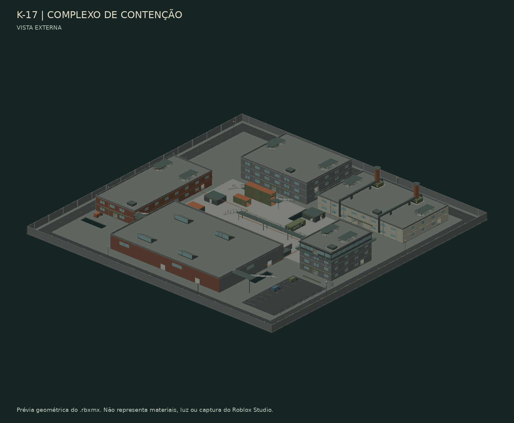

# Zombie Outbreak Reborn

Zombie Survival / Zombie Mod em Luau para Roblox Studio. **Mapa ativo: K-17.**

## K-17 — Complexo de Contenção

Mapa novo, independente de Santa Aurora e Harbor, com aproximadamente **600 × 600
studs**. Cinco edifícios com interiores, três acessos ao subterrâneo, coberturas,
galerias, contêineres e 15 posições de resistência identificadas.

- Administração com três andares e escritórios subdivididos.
- Estação de energia com dois andares e ligação elevada à administração.
- Fundição com prensas, esteiras, ponte rolante, postos de solda e mezanino.
- Depósito de dois andares com estantes e ligação à galeria da fundição.
- Torre de controle com quatro andares.
- Pátio industrial, tubulações, estacionamento, vans e circuito de manutenção.

[Documentação e roteiro de teste](docs/K17.md) · [Planta](docs/K17_PLAN.svg) ·
[Pesquisa realizada e limitações](docs/K17_REFERENCES.md)

**Novo: [barricadas interativas no estoque do depósito](docs/BARRICADES.md).**
Dois armários, uma mesa tombada e duas caixas podem ser reposicionados por humanos
e destruídos pelos zumbis. E seleciona/confirma, R gira e X cancela.
Preparação de 35 segundos; reset dos objetos a cada nova rodada.



## Abrir no Windows

1. No GitHub Desktop, selecione **main**, faça **Fetch origin → Pull origin**.
   Preserve eventuais alterações locais antes de atualizar.
2. Salve uma cópia do seu place atual como backup.
3. No Studio, use **File → Open from File** e abra:
   **`builds/ZombieOutbreakReborn_K17.rbxl`**.
4. Selecione `Workspace → ZO_K17Foundry` e pressione **F**.
5. Use Play para explorar. Para iniciar as rodadas, teste com dois jogadores.

Para experimentar as barricadas sozinho, durante Play use a Command Bar em
contexto **Server**:

```lua
require(game.ServerStorage.ZO_Validation.BarricadeAudit).practice("Humans")
```

Isso leva você ao estoque em treino exclusivo do Studio. Para testar os golpes,
repita com `"Zombies"`. Veja os controles e limites em [Barricadas](docs/BARRICADES.md).

O arquivo já contém o mapa, os scripts e a iluminação. É um place binário nativo
compactado; não exige GLB, Toolbox, upload de meshes ou Codex local.
É uma compilação desta entrega: depois de editar os fontes, recompile ou sincronize.

## Onde estão os fontes

```text
scripts/build_k17.py               construção original do mapa
src/maps/k17/K17Foundry.rbxmx       cena persistente gerada
src/maps/k17/*.luau                configurações e diagnóstico do K-17
src/maps/k17/barricades/           objetos, autoridade, controles e posicionamento
src/server/                       combate e rodadas compartilhados
src/client/                       interface, rifle e controles
scripts/validate_k17.py            checagem de colisão e circulação
tests/k17/K17Audit.luau            auditoria preparada para o Studio
```

A geração acontece no desenvolvimento; não há gerador de cenário rodando durante
as partidas. Edite o construtor para mudanças permanentes na arquitetura.

## Sincronizar e compilar

Instale Rojo **7.7.1**. Na raiz do repositório:

```sh
rojo serve default.project.json
```

Conecte o plugin Rojo no Studio. Use um place de teste separado para evitar
sobreposição com mapas antigos preservados no seu Workspace.
Se o servidor Rojo já estava aberto antes do Pull, encerre-o e inicie novamente
com o comando acima; depois reconecte o plugin para carregar o perfil novo.

Python padrão basta para gerar/verificar; no Windows, `py` pode substituir `python`:

```sh
python scripts/build_k17.py
python scripts/build_k17.py --check
python scripts/build_k17_barricades.py --check
python scripts/validate_k17.py --quiet
python -m unittest discover -s tests -p 'test_*.py'
rojo build default.project.json --output builds/ZombieOutbreakReborn_K17.rbxl
```

A CI compila e disponibiliza um artifact atualizado do place. As imagens são
prévias geométricas do modelo: não representam materiais, iluminação ou gameplay
renderizados pelo Roblox Studio.

## Estado de validação

**Executado na nuvem:** geração, compilação Luau/Rojo, 175 percursos com 33.341
amostras de apoio/espaço livre, oito testes de geometria e 85 asserções das regras
de barricadas. Os percursos também foram checados com os cinco objetos presentes.

**Pendente no Studio:** Humanoid, navegação real, aparência, FPS/streaming,
controles/colisões das barricadas, multiplayer e equilíbrio. Ainda não se afirma qualidade visual equivalente ao
Counter-Strike ou desempenho aprovado.

Durante Play, na Command Bar em contexto **Server**:

```lua
require(game.ServerStorage.ZO_Validation.K17Audit)()
```

Envie as linhas `[K17 AUDIT]` e os erros do Output para investigar falhas.
A navegação calculada não substitui caminhar pelos acessos nem testar com jogadores.

## Mapa anterior preservado

Santa Aurora continua disponível, sem alteração em seu modelo, gerador ou build:

```sh
rojo serve santa-aurora.project.json
```

Ou abra `builds/ZombieOutbreakReborn_SantaAurora.rbxlx` diretamente.
O projeto anterior está no commit `63b3546` e na branch de backup
`backup/before-k17-63b3546`. A documentação histórica que menciona
`default.project.json` para Santa Aurora deve usar o perfil preservado acima.

Os GLBs e modelos antigos permanecem no histórico e não são carregados no K-17.
