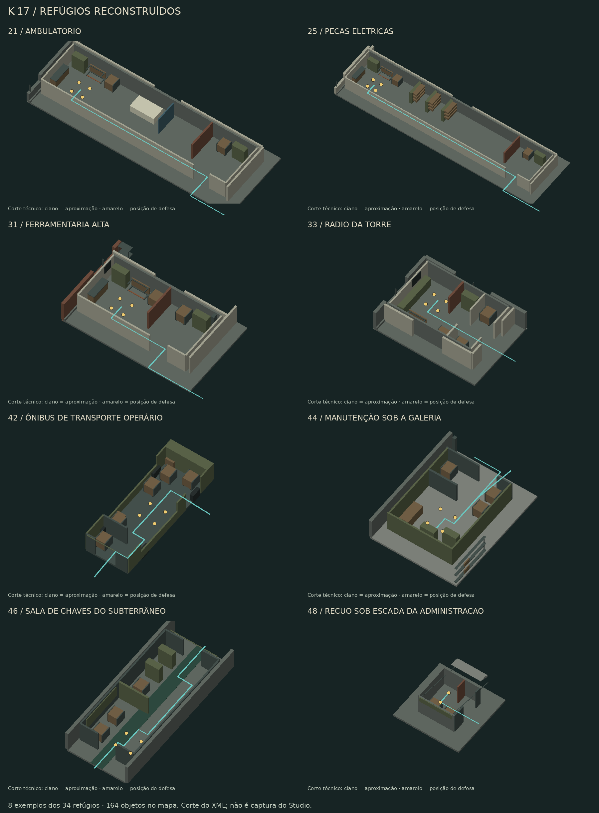

# Zombie Outbreak Reborn

Zombie Survival / Zombie Mod em Luau para Roblox Studio. **Mapa ativo: K-17.**

## K-17 — Complexo de Contenção

Mapa novo, independente de Santa Aurora e Harbor, com aproximadamente **600 × 600
studs**. Cinco edifícios com interiores, três acessos ao subterrâneo, coberturas,
galerias, contêineres e 44 marcadores de resistência, dos quais 34 identificam
refúgios com interiores detalhados.

- Administração com três andares e escritórios subdivididos.
- Estação de energia com dois andares e ligação elevada à administração.
- Fundição com prensas, esteiras, ponte rolante, postos de solda e mezanino.
- Depósito de dois andares com estantes e ligação à galeria da fundição.
- Torre de controle com quatro andares.
- Pátio industrial, tubulações, estacionamento, vans e circuito de manutenção.

[Documentação e roteiro de teste](docs/K17.md) · [Planta](docs/K17_PLAN.svg) ·
[Pesquisa realizada e limitações](docs/K17_REFERENCES.md)

[Revisão de projetos abertos de Zombie Mod para CS2 e CS:GO](docs/CS_ZOMBIE_OPEN_SOURCE.md):
referências verificadas de infecção, knockback e diferenças do protótipo atual.

**Atual: [34 refúgios detalhados e 164 objetos de barricada](docs/K17_DEFENSE_DENSITY.md).**
Revisão de mecânica: [tiros, golpes e resistência ao empurrão corporal](docs/BARRICADE_GAMEPLAY.md).
**[Pacote de combate](docs/CLASSIC_COMBAT_PACK.md): cinco armas, loja na tecla B,
troca de equipamento, créditos, munição por arma e contenção do avanço por tiros.**
**[AR reutilizada do Roblox Weapons Kit](docs/REUSED_WEAPON_KIT.md): a carabina
inicial usa mesh, sons, flash, ferrolho e animações R15 do kit; as outras quatro
armas mantêm os modelos provisórios.** O controlador de combate permanece o do K-17.
Infecção por golpe, primeiros infectados transformados no local, armas automáticas e semiautomáticas,
recarga temporizada e knockback configurável. A prévia de construção anterior
está desativada. **34 refúgios detalhados, quatro dutos e 164 objetos de barricada.** Há salas com entrada única, alas protegidas em vários andares, ônibus transitável, salas subterrâneas e recuos sob escadas. **M abre o mapa tático** com filtros por andar e tipo.



## Abrir no Windows

1. No GitHub Desktop, selecione **main**, faça **Fetch origin → Pull origin**.
   Preserve eventuais alterações locais antes de atualizar.
2. Salve uma cópia do seu place atual como backup. Desconecte o plugin Rojo se
   estiver ligado ao projeto anterior.
3. Use **Repository → Show in Explorer** no GitHub Desktop e dê dois cliques
   em **`ABRIR_K17.cmd`**, na raiz do repositório. Ele confere o SHA-256 da
   entrega e abre o caminho completo de `builds/ZombieOutbreakReborn_K17.rbxl`.
4. Selecione `Workspace → ZO_K17Foundry` e pressione **F**.
5. Use Play para explorar; **M** abre o mapa, **B** o arsenal. Para iniciar as
   rodadas, teste com dois jogadores; com três há dois humanos defendendo um zumbi.

**“Recentes” reabre o place salvo anteriormente.** O Pull atualiza os arquivos
do Git e não troca o mapa de um place já aberto. O mapa urbano de dois prédios
e rua central é o Santa Aurora antigo, removido dos arquivos atuais.
O arquivo do K-17 tem `ZO_K17Foundry`, os 164 objetos e os quatro dutos; seu
binário foi decodificado para conferir esses itens e a ausência de Santa Aurora.

Se a associação de arquivos do Windows não abrir o Studio, o atalho mostra o
caminho exato. Use **File → Open from File** no Studio e selecione esse arquivo.
O atalho Windows ainda precisa ser executado no computador do usuário; esta
nuvem validou o conteúdo e o checksum, sem abrir o Studio.

Para visitar diretamente os locais alterados, durante **Play**, com um jogador,
use a **Command Bar em contexto Server**:

```lua
require(game.ServerStorage.ZO_Validation.RefugeAudit).visit(16)
```

Troque `16` por `19`–`34` ou `40`–`49` para visitar as novas posições. Use **M** para localizar todos os refúgios. Empurre os objetos
com tiros; o contato corporal encontra resistência e os golpes de zumbi desgastam
os objetos. **R** recarrega. Veja o [roteiro de comparação das forças](docs/BARRICADE_GAMEPLAY.md).
O [treino com alvos de combate](docs/CLASSIC_GAMEPLAY.md) também está disponível.

O arquivo já contém o mapa, os scripts, a iluminação e a AR extraída do kit.
É um place binário nativo compactado; não exige importar GLB, Toolbox, fazer
upload de meshes ou instalar Codex local. Os assets da AR ainda são carregados
pelos serviços Roblox e dependem de disponibilidade e permissões.
É uma compilação desta entrega: depois de editar os fontes, recompile ou sincronize.

## Onde estão os fontes

```text
scripts/build_k17.py               construção original do mapa
scripts/k17_refuges.py             interiores defensivos
scripts/k17_shelters.py            três abrigos novos e quatro dutos
scripts/k17_extra_refuges.py       dezesseis interiores defensivos adicionais
scripts/k17_covered_routes.py      oito abrigos e passagens cobertas
scripts/k17_stair_niches.py        dois recuos sob escadas
scripts/k17_catalog.py             reúne o catálogo-base e os objetos dos refúgios
scripts/build_k17_barricades.py    gera os modelos e a configuração dos 164 objetos
src/maps/k17/K17Foundry.rbxmx       cena persistente gerada
src/maps/k17/*.luau                configurações e diagnóstico do K-17
src/maps/k17/barricades/catalog.json catálogo-base de objetos e parâmetros físicos
src/maps/k17/barricades/           catálogo único, modelos e física dos objetos
src/maps/k17/gameplay/             combate, infecção por golpe, rodada e HUD atuais
src/maps/k17/gameplay/TacticalMap.client.luau mapa tático com filtros, aberto por M
src/third_party/roblox-weapon-kit/   AR e apresentação extraídas, sem scripts externos
third_party/roblox-weapon-kit/       kit original arquivado, origem e licenças
src/server/                       bootstrap compartilhado e protótipos desativados
src/client/                       cliente anterior e bootstrap compartilhado
scripts/validate_k17.py            checagem de colisão e circulação
tests/k17/K17Audit.luau            auditoria preparada para o Studio
```

A geração acontece no desenvolvimento; não há gerador de cenário rodando durante
as partidas. Edite o construtor para mudanças permanentes na arquitetura.

## Sincronizar e compilar

Instale Rojo **7.7.1**. Na raiz do repositório:

```sh
rojo serve default.project.json
```

Conecte o plugin Rojo no Studio. Use um place de teste separado para evitar
sobreposição com mapas antigos preservados no seu Workspace.
Se o servidor Rojo já estava aberto antes do Pull, encerre-o e inicie novamente
com o comando acima; depois reconecte o plugin para carregar o perfil novo.

Python padrão basta para gerar/verificar; no Windows, `py` pode substituir `python`:

```sh
python scripts/build_k17.py
python scripts/build_k17_barricades.py
python scripts/build_k17.py --check
python scripts/build_k17_barricades.py --check
python scripts/validate_k17.py --quiet
python scripts/validate_refuges.py
python -m unittest discover -s tests -p 'test_*.py'
rojo build default.project.json --output builds/ZombieOutbreakReborn_K17.rbxl
python scripts/check_studio_file.py --write
```

A CI compila e disponibiliza um artifact atualizado do place. As imagens são
prévias geométricas do modelo: não representam materiais, iluminação ou gameplay
renderizados pelo Roblox Studio.

## Estado de validação

**Executado na nuvem:** geração, compilação Luau/Rojo, 213 percursos com 37.291
amostras de apoio/espaço livre, 17 testes de geometria e quatro de identidade/
licenças do kit, 160 asserções do combate/
rodada, 215 de inventário/economia e 96 de contenção. Os controladores reais
passaram 100 verificações de combate, 27 de rodada e 7.554 de barricadas com APIs
simuladas; há também 202 da política de impulso e 85 das regras preservadas. Verificação das fontes ativas
no place. Os percursos também foram checados com os 164 objetos presentes.

**Pendente no Studio:** Humanoid, navegação real, aparência, FPS/streaming,
controles/colisões das barricadas, multiplayer, equilíbrio e renderização/
permissões dos meshes, sons e animações da AR importada. Ainda não se afirma qualidade visual equivalente ao
Counter-Strike ou desempenho aprovado.

Durante Play, na Command Bar em contexto **Server**:

```lua
require(game.ServerStorage.ZO_Validation.K17Audit)()
```

Envie as linhas `[K17 AUDIT]` e os erros do Output para investigar falhas.
A navegação calculada não substitui caminhar pelos acessos nem testar com jogadores.

## Mapa antigo removido

Santa Aurora foi removido dos arquivos atuais: cena, build, perfil, gerador,
auditoria e documentação próprios. Há backup na branch
`backup/before-remove-santa-5b9ac4d` e um tar verificado na nuvem.
O K-17 é o único place pronto em `builds`; use `ABRIR_K17.cmd`.

A remoção pelo Git não fecha uma cópia antiga já aberta no Studio. Salve e
feche esse place e abra o K-17. O Rojo preserva objetos desconhecidos, portanto
use um place separado para não manter cenas antigas de arquivos locais.
