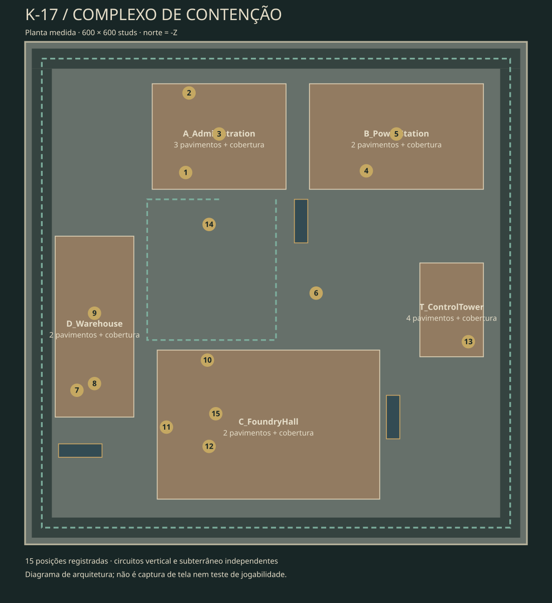

# K-17 — Complexo de Contenção

Mapa novo de Zombie Survival/Zombie Mod: área de aproximadamente **600 × 600
studs**, cinco edifícios independentes, interiores, coberturas, passarelas de
manutenção, contêineres, pátio de carga e rede subterrânea. Zombie Escape está
desativado no perfil deste mapa. A geometria não deriva de Santa Aurora ou Harbor.



[Vista geométrica externa](K17_OVERVIEW.png) · [Corte do térreo](K17_GROUND.png) ·
[Corte do subterrâneo](K17_UNDERGROUND.png). São visualizações dos objetos reais
do modelo; não representam os materiais e a iluminação renderizados pelo Studio.

## Abrir no Roblox Studio

1. No GitHub Desktop, selecione `main`, faça Fetch/Pull e preserve alterações locais.
2. Salve um backup do place em que estava trabalhando.
3. Abra `builds/ZombieOutbreakReborn_K17.rbxl` em **File → Open from File**.
4. No Explorer, selecione `Workspace → ZO_K17Foundry` e pressione **F**.
5. Faça Play para explorar, ou teste local com dois clientes para iniciar rodadas.

O `.rbxl` binário é uma compilação compactada do jogo completo, não um GLB nem um
modelo a ser importado. Não requer Codex local, upload de meshes ou Toolbox.

Para sincronizar scripts/cena após futuras alterações:

```sh
rojo serve default.project.json
```

Conecte o plugin Rojo no Studio. O mapa é gerado e controlado pelo Rojo: alterações
manuais no modelo podem ser substituídas na próxima sincronização/regeneração.
Use um place separado para testar K-17. Objetos de mapas antigos desconhecidos
pelo projeto não são apagados automaticamente de um Workspace já existente.
Após atualizar o repositório, reinicie um servidor Rojo que já estivesse aberto
e reconecte o plugin. A instância antiga pode continuar expondo o perfil anterior.

## Organização arquitetônica

| Setor | Conteúdo e circulação |
| --- | --- |
| A — Administração | Três andares, escritórios subdivididos, arquivos, corredores, duas escadas completas e cobertura acessível |
| B — Estação de energia | Dois andares, conversores elétricos, salas de controle, arquivos, duas escadas e cobertura; ponte para A |
| C — Fundição | Duas linhas de prensas, alimentação por esteiras, ponte rolante, postos de solda, bancadas e depósito; galeria em circuito com duas escadas e cobertura com dois acessos externos |
| D — Depósito | Dois andares, salas de armazenamento, estantes e corredor longitudinal; duas escadas, cobertura e ligação com a galeria de C |
| T — Torre de controle | Quatro andares com salas, dois núcleos de escada e cobertura de observação |
| Y — Pátio | Logística em contêineres, galeria de inspeção de tubulações, vans abandonadas, estacionamento, vias perimetrais e portão de quarentena |
| U1 — Manutenção | Circuito de túneis, três escadarias independentes, canais rasos de drenagem e sala de bombas com duas portas |

As salas têm acesso por portas reais. A ala de escadas liga os núcleos ao corredor
central; os vãos dos pisos acompanham as escadas. Vidros têm colisão e não são
quebráveis nesta versão. Barricadas de madeira são cobertura estática; não há
sistema interativo de arrastar/construir/destruir barricadas nesta entrega.

### Escala

- Pisos principais: Y=1; altura entre pavimentos: 14 studs.
- Coberturas: A=43, B=29, C=29, D=29, T=57.
- Subterrâneo: piso Y=-24; teto principal Y=-13,5.
- Corredores principais dos prédios: 16 studs; túneis: geralmente 20 studs.
- Portas de pedestres: 10–12 studs livres; escadas: 10–12 studs.
- Degraus: até 0,5 stud de subida nos núcleos e acessos subterrâneos.
- Avatares da verificação: raio 1,5, altura 5,5, passo máximo aproximado de 1 stud.

## Quinze posições de resistência

Os marcadores ficam em `ZO_K17Foundry → DefensePoints`, invisíveis no jogo.
Contêm identificação, vantagem e risco. Não são zonas de invulnerabilidade.

| ID | Posição | Vantagem | Invasão / risco |
| --- | --- | --- | --- |
| 01 | Sala de briefing | Portas e recuo interno | Corredor ou ala posterior |
| 02 | Arquivo no andar superior | Sala recuada | Duas portas e cobertura limitada |
| 03 | Cobertura da administração | Altura e visão do pátio | Dois núcleos de escada; exposição |
| 04 | Controle da energia | Sala próxima à ponte | Corredor e ala de escadas |
| 05 | Cobertura da energia | Espaço para recuar | Duas escadas e céu aberto |
| 06 | Galeria de tubulações | Linha de tiro elevada | Ataque pelas duas extremidades |
| 07 | Estoque do depósito | Estantes e entrada estreita | Flanco pela sala vizinha |
| 08 | Corredor superior do depósito | Visibilidade longitudinal | Ambos os núcleos chegam ao andar |
| 09 | Cobertura do depósito | Altura e recuo | Duas escadas |
| 10 | Recebimento barricadado | Cobertura baixa | Porta principal e lateral aberta |
| 11 | Galeria da fundição | Visão do maquinário | Duas escadas e ponte do depósito |
| 12 | Cobertura da fundição | Claraboias e área elevada | Duas escadas externas |
| 13 | Controle da torre | Sala no quarto andar | Duas escadas desembocam no corredor |
| 14 | Contêiner superior | Interior comprido e elevado | Escada alcançável; saída oposta leva a queda |
| 15 | Sala de bombas | Duas portas controláveis | Pode ser cercada pelos dois túneis |

Cada ponto tem apoio e ligação com percursos na geometria verificada. Isso não
comprova que resistir nele é equilibrado; knockback, saltos, quantidade de jogadores
e escala dos avatares precisam ser testados no motor.

## Validação executada

- Geração determinística com Python padrão, sem baixar ou converter assets.
- **175 percursos**, com **33.341 amostras** de apoio/espaço livre contra as
  colisões do XML real, incluindo escadas, salas, pontes, túneis e resistências.
- Checagem das 15 posições, larguras das portas, ancoragem e orçamento da cena.
- Controles negativos: parede fechando a entrada, teto selando o acesso ao esgoto
  e piso de ponte removido precisam ser rejeitados pelo verificador.
- Compilação Luau, compilação Rojo para XML e binário, presença do mapa, scripts,
  spawns e iluminação no resultado. A contagem de instâncias do binário é
  comparada com a compilação XML.
- Projeto anterior recompilado separadamente para conferir sua preservação.

O verificador faz uma aproximação conservadora do corpo com apoio por amostragem.
Não executa Humanoid, físicas, o navmesh do Roblox, streaming de cliente ou GPU.

## Auditoria preparada para o Studio — ainda não executada

Durante Play, na Command Bar em contexto **Server**:

```lua
require(game.ServerStorage.ZO_Validation.K17Audit)()
```

O módulo tenta 29 verificações: três pisos de spawn, quinze marcadores presentes,
22 caminhos calculados e três linhas de visão. Cada resultado é impresso com
`[K17 AUDIT]`. A checagem de marcadores é um teste único, não quinze playtests.
O PathfindingService pode escolher outra rota: sucesso não prova qual escada foi
usada nem substitui caminhar por ela.

Roteiro manual:

1. Caminhar por cada sala e subir/descer as escadas sem pular. Conferir vãos,
   patamares, portas da ponte, cobertura e as três entradas do subterrâneo.
2. Confirmar o circuito da galeria: passar ao lado dos vãos das duas escadas.
3. Testar cada posição como humano e como zumbi; verificar as aproximações
   indicadas, possíveis saltos para equipamentos e acesso ao contêiner superior.
4. Com dois clientes, conferir rodadas, infectado inicial, infecção por porta
   aberta e bloqueio por parede/vidro, armas, recarga, morte e vitória.
5. Conferir iluminação e legibilidade em qualidade gráfica baixa e alta.
6. Medir frame time, memória e streaming em dispositivo alvo e servidor com a
   lotação pretendida. Não há medição de FPS ou orçamento de rede confirmado.

## Medidas de desempenho aplicadas

- 5.360 Parts ancoradas distribuídas entre modelos de edifícios/setores; não há
  animação de cenário por frame, física de detritos ou gerador executado no jogo.
- Repetições de molduras, caixas e postes foram reduzidas durante a construção.
- Streaming habilitado com raio mínimo 96 e alvo 256 studs.
- 90 luzes locais, somente oito com sombras; iluminação global atmosférica.
- Detalhes pequenos não participam de colisão, toque ou consultas de tiro.
- Layout e checagens têm orçamentos explícitos para conter crescimento gratuito.

Essas são medidas de construção. Desempenho adequado ao multiplayer só pode ser
afirmado após medição real. Não foram adicionadas texturas externas ou PBR próprio:
concreto, tijolo, metal corroído, vidro e madeira usam materiais do Roblox.

## Fontes e manutenção

- `scripts/build_k17.py`: arquitetura original e gerador do mapa.
- `src/maps/k17/K17Foundry.rbxmx`: modelo persistente gerado.
- `src/maps/k17/*.luau`: configuração e diagnóstico específicos deste mapa.
- `scripts/validate_k17.py`, `tests/test_k17_geometry.py`: verificações na nuvem.
- `tests/k17/K17Audit.luau`: auditoria preparada para o Studio.
- `docs/k17-navigation.json`: percursos, posições e metadados arquitetônicos.
- [Referências e limites da pesquisa](K17_REFERENCES.md).

```sh
python scripts/build_k17.py
python scripts/build_k17.py --check
python scripts/validate_k17.py --quiet
python -m unittest discover -s tests -p 'test_*.py'
rojo build default.project.json --output /tmp/k17-validation.rbxlx
python scripts/validate_k17.py --quiet --place /tmp/k17-validation.rbxlx
rojo build default.project.json --output builds/ZombieOutbreakReborn_K17.rbxl
```

No Windows, `py` pode substituir `python`; use um destino local para o XML
temporário. Não regenere o mapa durante um playtest.

## Preservação de Santa Aurora

Base preservada: `63b3546f406e8502ff5a80b56d3bc0b95c192550`.
O modelo, o gerador, os scripts do jogo e o build anterior não foram editados.
`santa-aurora.project.json` conserva integralmente a configuração anterior:

```sh
rojo serve santa-aurora.project.json
```

Onde a documentação histórica de Santa Aurora usa `default.project.json`, use
esse perfil preservado. O perfil padrão passou a carregar o mapa novo K-17.
