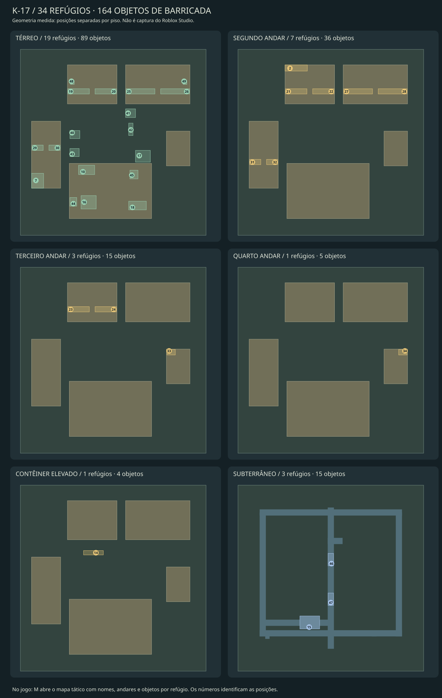

# K-17 — mais opções de abrigo e barricada

A revisão amplia de **8 para 34 refúgios detalhados**, de **40 para 164 objetos
físicos de barricada** e de **18 para 44 posições de resistência registradas**.
São 26 abrigos novos e 124 objetos adicionais. Os dez marcadores restantes
identificam coberturas e posições abertas já existentes; não são dez salas novas.



[Oito cortes representativos da geometria real](K17_REFUGES.png). As imagens são
prévias técnicas geradas do cenário, sem renderização do Roblox Studio.

## O que mudou no espaço de jogo

- **Administração:** recepção com entrada em L, almoxarifado de TI, ambulatório,
  cabine de projeção, arquivo contábil e gerência recuada, distribuídos nos três
  andares. As divisórias fecham a visão direta e deixam uma entrada para defender.
- **Energia:** peças elétricas, oficina, controle de redes e operação de chaves,
  com armários, bancada, caixas e equipamento próprio do setor.
- **Depósito:** quatro salas de separação, embalagem, ferramentas e vigia.
- **Torre:** sala de rádio no terceiro andar e instrumentos no quarto.
- **Pátio e fundição:** abrigo de vapor, galeria de carga, ônibus com interior
  transitável, baia de paletes, manutenção sob a galeria e ferramentaria.
- **Subterrâneo:** sala de chaves e posto de drenagem com anteparos reais,
  teto e caminhos de aproximação pelas duas extremidades.
- **Sob escadas:** dois recuos menores, na administração e na energia, cada
  um com anteparo, entrada lateral e duas caixas de barricada.

Os quatro dutos com curva continuam presentes nos refúgios anteriores.
Os novos abrigos usam paredes, retornos de entrada, tetos e mobiliário para
reduzir exposição; não são apenas marcadores em área aberta. Os novos esconderijos
possuem um ponto com a visão bloqueada desde a aproximação indicada na validação.
Isso não significa invisibilidade a quem entre, use outro ângulo ou salte.

A maioria das novas salas internas tem **uma entrada de 6 studs**. Isso permite
concentrar a defesa, mas deixa o grupo sem saída se a barricada cair. Ônibus,
galeria de carga, triagem e salas subterrâneas exigem vigiar dois acessos.
Não existe zona invulnerável ou passagem exclusiva para humanos.

## Encontrar e testar as mudanças

1. No GitHub Desktop, selecione **main → Fetch origin → Pull origin**.
2. Salve o place atual. Abra **ABRIR_K17.cmd**, na raiz do repositório, para
   conferir o checksum e abrir o arquivo K-17 correto. Pull não substitui um
   place já aberto no Studio.
3. Use **Play** e pressione **M**. Há filtros por andar e tipo; a lista permite
   selecionar cada refúgio e ver quantidade de entradas e objetos.
4. Visite primeiro **21** (ambulatório), **33** (rádio), **42** (ônibus),
   **46** (subterrâneo) e **48** (sob escada), que mostram situações diferentes.
5. Empurre caixas, mesas e armários até os acessos com tiros. O contato corporal
   encontra resistência na [revisão de mecânica](BARRICADE_GAMEPLAY.md). **R**
   recarrega. O mapa tático suspende os disparos locais enquanto estiver aberto.

**M** também tem botão na tela para toque e atalho View no gamepad.
O mapa mostra a posição local e os refúgios; não mostra inimigos nem teletransporta.
A interface está compilada, mas ainda precisa de execução e revisão visual no Studio.

Para inspeção rápida em treino solo, use a Command Bar no contexto **Server**:

```lua
require(game.ServerStorage.ZO_Validation.RefugeAudit).visit(42)
```

Troque `42` por um ID da tabela. Esse comando é uma ferramenta de auditoria
limitada ao Studio; não é uma opção de teletransporte do jogo.

Os objetos não têm modo de agarrar ou inventário de construção. Tiros humanos
empurram sem retirar sua vida; golpes de zumbi empurram e danificam. A preparação
da rodada repõe os objetos. A física continua no servidor; a manutenção foi
ajustada para reduzir trabalho desnecessário com o catálogo ampliado.

## Posições detalhadas

“Pontos” são lugares separados checados para um corpo aproximado de raio 1,5 e
altura 5,5 studs. Não representam lotação aprovada em partida real. Nos recuos
sob escadas há dois pontos; os demais têm quatro. Entradas contam vãos físicos,
não o número de percursos que chegam ao mesmo vão.

| ID | Refúgio | Andar | Entradas | Objetos móveis | Pontos |
| --- | --- | --- | --- | --- | --- |
| 02 | Arquivo morto | 2º andar | 2 | 6 | 4 |
| 07 | Estoque de embalagem | Térreo | 2 | 8 | 4 |
| 10 | Posto de expedicao | Térreo | 2 | 6 | 4 |
| 14 | Conteiner de carga retida | Contêiner elevado | 2 | 4 | 4 |
| 15 | Baia de controle das bombas | Subterrâneo | 2 | 5 | 4 |
| 16 | Sala de filtros | Térreo | 2 | 4 | 4 |
| 17 | Oficina do patio | Térreo | 2 | 3 | 4 |
| 18 | Sala de refrigeracao | Térreo | 2 | 4 | 4 |
| 19 | Recepcao protegida | Térreo | 1 | 5 | 4 |
| 20 | Almoxarifado de TI | Térreo | 1 | 5 | 4 |
| 21 | Ambulatorio | 2º andar | 1 | 5 | 4 |
| 22 | Cabine de projecao | 2º andar | 1 | 5 | 4 |
| 23 | Arquivo contabil | 3º andar | 1 | 5 | 4 |
| 24 | Gerencia recuada | 3º andar | 1 | 5 | 4 |
| 25 | Pecas eletricas | Térreo | 1 | 5 | 4 |
| 26 | Oficina eletrica | Térreo | 1 | 5 | 4 |
| 27 | Controle de redes | 2º andar | 1 | 5 | 4 |
| 28 | Operacao de chaves | 2º andar | 1 | 5 | 4 |
| 29 | Picking de pecas | Térreo | 1 | 5 | 4 |
| 30 | Embalagem rapida | Térreo | 1 | 5 | 4 |
| 31 | Ferramentaria alta | 2º andar | 1 | 5 | 4 |
| 32 | Vigia do deposito | 2º andar | 1 | 5 | 4 |
| 33 | Radio da torre | 3º andar | 1 | 5 | 4 |
| 34 | Instrumentos da torre | 4º andar | 1 | 5 | 4 |
| 40 | Abrigo da manutenção de vapor | Térreo | 1 | 5 | 4 |
| 41 | Galeria de carga coberta | Térreo | 2 | 5 | 4 |
| 42 | Ônibus de transporte operário | Térreo | 2 | 5 | 4 |
| 43 | Triagem de paletes | Térreo | 2 | 5 | 4 |
| 44 | Manutenção sob a galeria | Térreo | 1 | 5 | 4 |
| 45 | Ferramentaria das prensas | Térreo | 2 | 5 | 4 |
| 46 | Sala de chaves do subterrâneo | Subterrâneo | 2 | 5 | 4 |
| 47 | Posto de controle da drenagem | Subterrâneo | 2 | 5 | 4 |
| 48 | Recuo sob escada da administracao | Térreo | 1 | 2 | 2 |
| 49 | Recuo sob escada da energia | Térreo | 1 | 2 | 2 |

## Verificado na nuvem

- Geração determinística da cena, catálogo resolvido de 164 objetos e metadados
  de todos os refúgios; nenhum modelo externo baixado nesta revisão.
- **213 percursos / 37.291 amostras**, incluindo apoio e espaço livre na geometria
  com os objetos nas posições iniciais. As entradas das salas substituídas foram
  conectadas aos corredores e às alas de escadas existentes.
- **132 pontos de defensores**, linhas de tiro, quatro dutos e os novos pontos
  de ocultação/cobertura superior verificados contra a geometria real.
- **17 testes Python**, com controles que precisam falhar ao bloquear entradas,
  retirar um piso, retirar o teto do ônibus ou retirar o anteparo sob escada.
- Compilação Luau; 202 asserções de impulso, 85 de regras de barricada e 160 de
  combate/rodada. Controladores reais executados com APIs simuladas: 24 asserções
  de início de rodada na etapa original; a [integração atual de combate](CLASSIC_COMBAT_PACK.md)
  inclui 27 verificações de rodada e 7.554 de barricadas, com catálogos de 164 e 180 objetos.
- Build Rojo XML e binário, integração das fontes ativas e inspeção do conteúdo
  nativo/checksum antes de atualizar o arquivo entregue.

**Ainda depende do Studio:** aparência, legibilidade da interface, movimentação
real do Humanoid, contato/empilhamento/estabilidade dos objetos, tiros e golpes
multiplayer, equilíbrio e FPS. As simulações não executam a física Roblox nem
comprovam desempenho com 164 objetos móveis. São 5.431 Parts estáticas separadas
dos conjuntos móveis, 94 luzes locais e oito luzes com sombras.

Antes de mover objetos, em Play, contexto Server:

```lua
require(game.ServerStorage.ZO_Validation.RefugeAudit).run()
require(game.ServerStorage.ZO_Validation.BarricadeAudit).run()
```

Depois teste com dois clientes: preparar barricada em uma sala de entrada única,
infectar um jogador, derrubar a defesa e conferir a reposição na rodada seguinte.
Compare também uma posição com dois acessos. Observe colisões, saltos sobre a
barricada, deslocamento visto pelos dois clientes e tempo de quadro.

## Fontes e preservação

- `scripts/k17_extra_refuges.py`: 16 salas internas.
- `scripts/k17_covered_routes.py`: oito abrigos de pátio, fundição e subterrâneo.
- `scripts/k17_stair_niches.py`: dois recuos sob escada.
- `scripts/k17_catalog.py`: une os 40 objetos de base aos objetos definidos nos
  novos layouts. O catálogo resolvido está em `docs/k17-navigation.json` e gera
  `Config.luau` / `Stockroom.rbxmx`; não edite esses resultados separadamente.
- `scripts/build_k17.py`: integra a arquitetura e gera `Refuges.luau` e a cena.
- `src/maps/k17/gameplay/TacticalMap.client.luau`: mapa tático.

Santa Aurora foi removido dos arquivos atuais conforme solicitado. A versão
anterior está na branch `backup/before-remove-santa-5b9ac4d` e em tar verificado
na nuvem. O histórico Git foi preservado. Essa remoção não fecha cópias locais
antigas que já estejam abertas no Roblox Studio.
