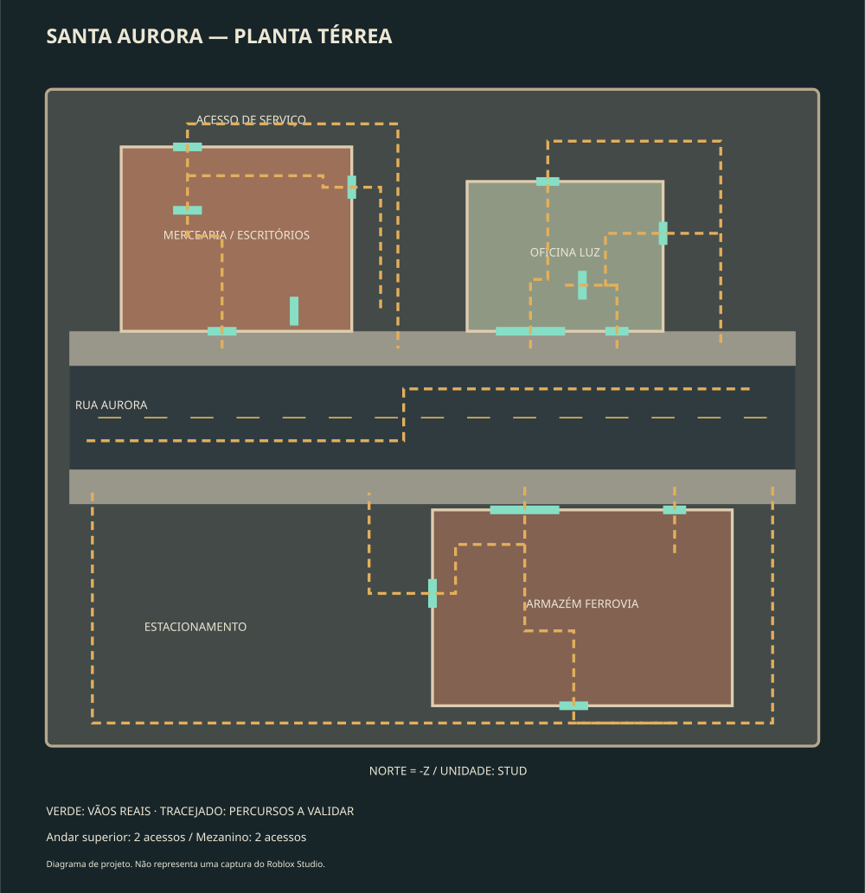

> Mapa anterior preservado. O projeto atual é K-17: use `ABRIR_K17.cmd` ou `builds/ZombieOutbreakReborn_K17.rbxl`. Este documento descreve apenas Santa Aurora.

# Distrito Santa Aurora — primeira área urbana

Uma rua comercial atende um pequeno quarteirão de serviços: mercearia com
administração no andar superior, oficina com recepção e um armazém de cargas com
mezanino. As ruas foram fechadas para quarentena. O estacionamento pertence aos
comércios; os acessos traseiros servem ao estoque e à carga. Não há dependência de
GLB, Toolbox, meshes publicados ou plugins externos para ver o mapa.

Esta entrega é uma primeira área construída e mobiliada. Ainda não representa
arte final fotorrealista, desempenho medido ou jogabilidade aprovada no Studio.
Os materiais são nativos do Roblox; não foram adicionadas texturas PBR externas.



## Escala e circulação

- Quarteirão: 268 × 228 studs; rua com 36 studs e calçadas com 12 studs.
- Pisos da loja e do armazém: Y=1; escritórios: Y=16; mezanino: Y=14.
- Portas de pedestres: pelo menos 8 studs livres e 10 studs de altura.
- Escadas: 10 studs de largura; degraus de até 0,75 stud de subida.
- Avatares de referência da checagem: raio 1,5 e altura 5,5 studs. Avatares
  maiores ou escalas personalizadas exigem outro teste.
- 1.138 Parts ancoradas; 22 luzes locais, das quais somente seis projetam sombras.
  Isso é um orçamento de construção, não uma medição de FPS ou draw calls.

| Setor | Interiores e função | Rotas |
| --- | --- | --- |
| Mercearia Aurora | Caixa, gôndolas, refrigerador e estoque | Entrada frontal, saída do estoque e porta lateral |
| Administração | Duas salas, mesas, reunião e copa | Escada interna e escada de incêndio externa |
| Oficina Luz | Box de manutenção, bancada de ferramentas e recepção | Garagem, recepção, porta traseira e porta lateral |
| Armazém Ferrovia | Recebimento, estantes e arquivo no mezanino | Portão de carga, acesso de pessoal, saída traseira e oeste |
| Mezanino | Supervisão do galpão e trabalho administrativo | Escada interna e escada externa pelo pátio |
| Exterior | Rua, travessia, estacionamento e vias de serviço | Circuitos contornam os prédios pelos dois lados |

Os espaços de defesa têm acessos alternativos. As portas estão abertas de fato:
não são retângulos pretos pintados numa parede. As janelas são fechadas por vidro
com colisão; não são passagens ou janelas quebráveis nesta versão.

## Organização dos arquivos

- `scripts/build_santa_aurora.py`: planta e construção determinística em Python
  padrão. Gera o modelo XML e os dados de circulação sem baixar assets.
- `src/maps/santa-aurora/SantaAurora.rbxmx`: mapa persistente e editável no Studio.
- `santa-aurora.project.json`: liga esse modelo ao Workspace e define a iluminação.
- `src/shared/MapConfig.luau`: nome do mapa e dos marcadores de spawn.
- `docs/santa-aurora-geometry.json`: manifesto para verificação de circulação.
- `scripts/validate_santa_aurora.py`: checagem de apoio e espaço livre baseada nas
  colisões do XML real; lê o manifesto apenas para os percursos e dimensões.
- `tests/studio/SantaAuroraAudit.luau`: auditoria opcional no motor do Roblox.
- `builds/ZombieOutbreakReborn_SantaAurora.rbxlx`: jogo compilado para abrir direto.

O `.rbxmx` é controlado pelo Rojo: alterações nele pelo Studio podem ser
sobrescritas na próxima sincronização. Faça mudanças permanentes no gerador ou
estabeleça outro responsável por esse modelo antes de editá-lo manualmente.

## Verificações executadas na nuvem

1. Geração determinística, com `--check` sem diferenças.
2. Quatorze percursos com amostragem a cada 0,5 stud, incluindo as quatro escadas.
   Checa apoio do pé e interseção aproximada do corpo contra as colisões reais.
3. Compilação dos 11 arquivos Luau com o compilador oficial Luau.
4. Compilação Rojo 7.7.1; verificação de mapa, spawns, iluminação e scripts no
   place compilado. O mapa Harbor antigo não está incluído no novo place.

Essa amostragem não executa Humanoid, física, streaming ou PathfindingService.
Ela identifica obstruções e pisos ausentes antes da validação no Studio.

## Validação no Roblox Studio — ainda pendente

Abra o `.rbxlx` fornecido como um place separado. Assim uma importação antiga não
fica sobreposta ao novo mapa. Salve um backup do seu place anterior antes de
sincronizar qualquer mudança nele.

Em **Play**, selecione o contexto **Server** na Command Bar e execute:

```lua
require(game.ServerStorage.ZO_Validation.SantaAuroraAudit)()
```

A auditoria tenta 13 verificações: três pisos de spawn, quatro linhas de visão e
seis caminhos calculados pelo motor. Ela imprime cada resultado com `[ZO AUDIT]`.
Ainda não foi executada neste ambiente Linux. Um caminho calculado também não
comprova que o jogador consegue caminhar ou que usou a escada pretendida.

Teste manual obrigatório:

1. Com um jogador, caminhe por todas as entradas e suba/desça cada escada sem
   pular. Confira teto, patamares, colisão do vidro e guarda-corpos.
2. Confirme que mesas, prateleiras e carros não bloqueiam os caminhos principais.
3. Inicie teste local com dois clientes. Confirme preparação, primeiro infectado,
   contador e término de rodada. Confira os dois spawns e a câmera de primeira pessoa.
4. Posicione humano e zumbi a menos de 4,5 studs em lados opostos de uma parede:
   não deve ocorrer infecção. Repita através de uma porta aberta: deve infectar.
5. Teste dano do rifle, recarga, retorno após morte e acesso dos zumbis aos dois
   pavimentos elevados. O sistema de combate continua sendo o protótipo existente.
6. Inspecione o cenário com qualidade gráfica baixa e alta; registre FPS/frame
   time no dispositivo alvo antes de afirmar que o mapa está otimizado.

Envie as linhas `[ZO AUDIT]` e os erros do Output para diagnosticar falhas.
Não publique por cima do jogo principal antes de conferir o teste local.

## Recompilar

```sh
python scripts/build_santa_aurora.py
python scripts/build_santa_aurora.py --check
rojo build santa-aurora.project.json --output builds/ZombieOutbreakReborn_SantaAurora.rbxlx
python scripts/validate_santa_aurora.py --place builds/ZombieOutbreakReborn_SantaAurora.rbxlx
```

No Windows, `py` pode substituir `python`. A geração não precisa de NumPy,
trimesh, Blender ou Studio. A CI atual recompila Santa Aurora para conferir sua preservação; o artifact
disponibilizado ao usuário contém K-17. Compilação não é playtest.

## Preservação do projeto anterior

Base anterior: commit `34b08175968a5420e35229037b64bb7ca933110b`.
Branch local de preservação: `backup/before-santa-aurora-34b0817`.
Um arquivo completo do conteúdo versionado foi criado e conferido antes das
edições em `/workspace/backups/zombie-outbreak-reborn/`. Os GLBs e modelos
anteriores continuam no Git, mas não são montados pelo projeto ativo.
